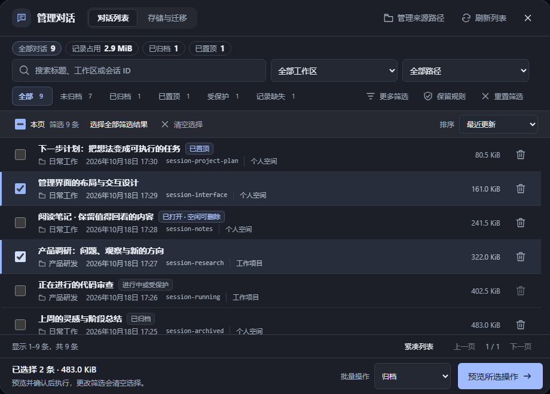
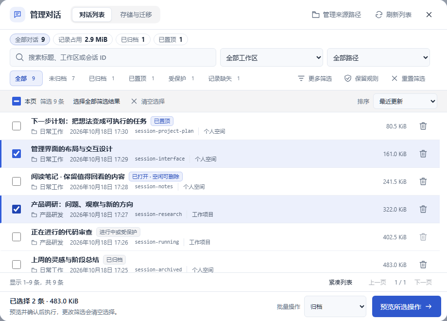
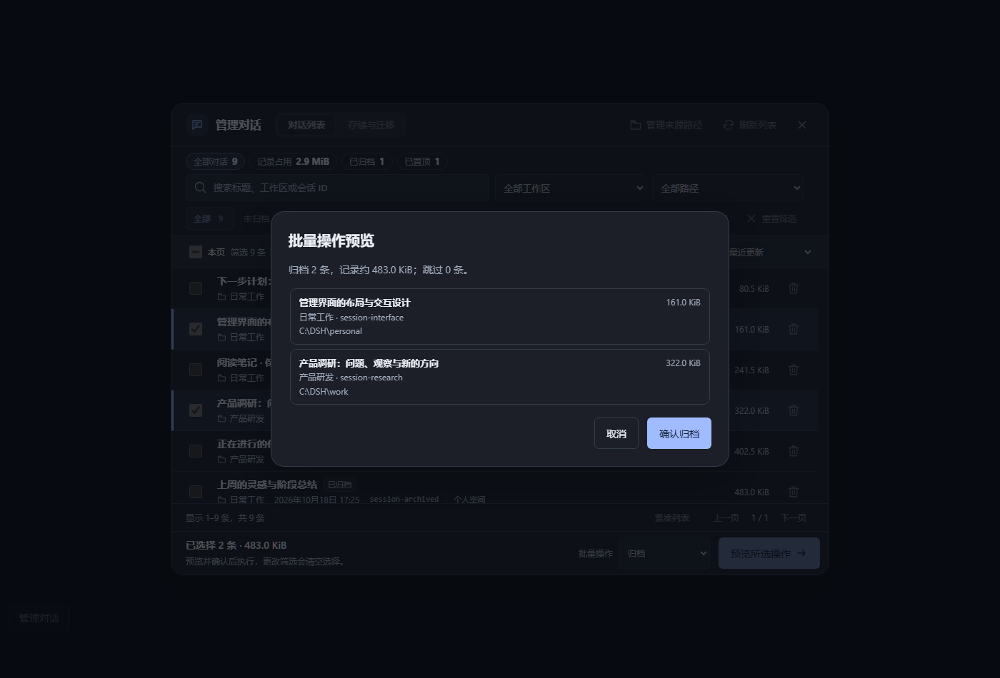
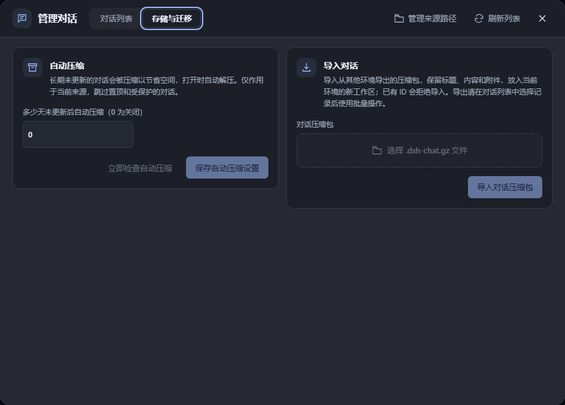
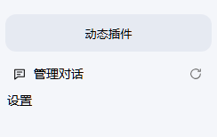
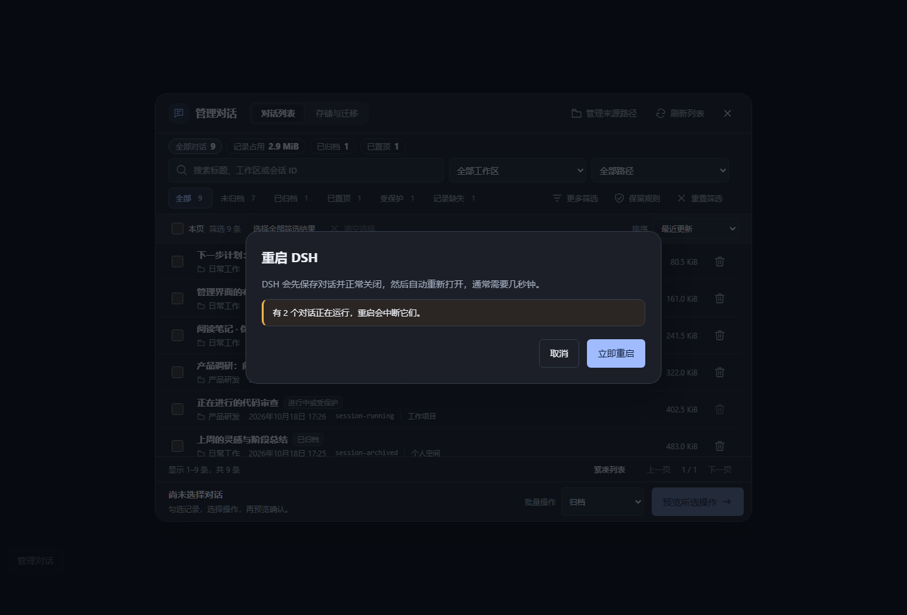

<p align="center">
  
</p>

<h1 align="center">DSH Chat Prune</h1>

<p align="center">
  <strong>为 DSH NEXT 深度打造的会话全生命周期管理插件</strong><br>
  统一看板 · 智能检索 · 批量归档 · 空间压缩 · 跨机迁移 · 保姆级安全修剪
</p>

<p align="center">
  <a href="https://github.com/Cans518/dsh-chat-prune/releases/latest"></a>
  <a href="https://github.com/Cans518/dsh-chat-prune/actions/workflows/ci.yml"></a>
  <a href="./LICENSE"></a>
  
  
  
  
  <a href="./CONTRIBUTING.md"></a>
</p>

<p align="center">
  
  
  
  
</p>

<p align="center">
  <a href="#-界面预览">界面预览</a> ·
  <a href="#-核心特性">核心特性</a> ·
  <a href="#-快速安装">快速安装</a> ·
  <a href="#-快速上手">快速上手</a> ·
  <a href="#-数据安全与备份保障">数据安全</a> ·
  <a href="./docs/user-guide.md">使用指南</a> ·
  <a href="./docs/technical-reference.md">技术说明</a> ·
  <a href="./CHANGELOG.md">更新记录</a>
</p>

---

> [!NOTE]
> **💡 项目背景与初衷**  
> 在日常高频使用 DSH NEXT 进行开发的过程中，随着对话与项目增多，左侧工作区积攒了大量一次性调试对话、排查日志以及附带多张图片/附件的大型会话，本地磁盘占用往往不知不觉膨胀至数百 MB 甚至数 GB。原生界面缺乏便捷的批量整理、容量统计、旧记录归档与跨设备迁移能力。  
> **DSH Chat Prune** 是作者 [@Cans518](https://github.com/Cans518) 为解决自身使用痛点而发起的**个人独立开源项目**。秉承“零侵入宿主底层、极度注重数据安全、原生级视觉质感”的理念，为每一位 DSH NEXT 深度用户打造省心透明的会话管家。

> [!IMPORTANT]
> **⚠️ 开源独立性与免责声明**  
> 1. 本项目为**社区个人开源作品**，与 DSH NEXT / DeepSeek 官方团队无任何商业隶属或官方背书关系。  
> 2. 插件代码完全公开透明，基于 [MIT 许可证](./LICENSE) 免费提供。虽然插件在设计上实现了严格的“写入排它锁、空闲生命周期侦测、执行前只读清单校验、全量备份机制”，但在执行物理删除前仍请确认目标无误；对于不可抗力或系统异常引发的数据风险，请注意及时对重要数据进行冷备份。

---

## 📸 界面预览

### 1. 现代化统一管理看板（支持深色 / 浅色 / 自定义主题）
能够清晰查看所有工作区对话的标题、占用大小、物理文件更新时间、会话 ID、运行状态及所属数据来源。支持快捷筛选与紧凑排版切换：

| 深色模式 (Dark Theme) | 浅色模式 (Light Theme) |
|:---:|:---:|
|  |  |

### 2. 二次确认安全清单 & 存储压缩迁移面板
无论是批量归档、置顶、压缩还是删除，均提供执行前只读清单核对，展示影响条数与体积变化；支持一键压缩旧会话与 `.dsh-chat.gz` 跨设备打包导出导入：

| 批量操作预览核对 | 存储与跨机迁移面板 |
|:---:|:---:|
|  |  |

### 3. 原生侧边栏无缝嵌入 & 桌面端一键平滑重启
深度融入 DSH 侧边栏底部与单条会话右侧快捷按钮。Windows 桌面端专属重启能力，可在安全保存会话后一键重启生效新插件：

| 侧边栏原生入口 | 桌面端安全重启确认 |
|:---:|:---:|
|  |  |

---

## ✨ 核心特性

| 功能模块 | 对应图标 | 详细说明 |
|---|:---:|---|
| **原生深度集成** | 🧭 | 侧边栏单条会话悬浮垃圾桶快捷删除；底部原生嵌入“管理对话”入口与重启按钮，完美适配展开与折叠态 |
| **全景多维检索** | 🔍 | 毫秒级多条件组合过滤：按标题模糊匹配、工作区、数据来源、运行中/受保护状态、更新时间范围与体积排序 |
| **跨页批量管理** | 📦 | 跨分页连续点选，支持批量归档/取消归档、置顶/取消置顶、一键多选操作 |
| **存储空间压缩** | 🗜️ | 采用标准流式压缩，清理可重建投影缓存，体积立省 70%+；原生对话列表无感知保留，点开时按需毫秒级自动解压 |
| **自动静默压缩** | ⏳ | 支持配置“多少天未更新后自动压缩”（如 30 天）；后台每分钟静默调度，杜绝旧会话长期霸占 SSD 存储 |
| **跨设备迁移包** | 🔄 | 导出标准 `.dsh-chat.gz` 压缩包（包含会话历史、附件与元数据）；在新机器/新 Profile 安装后一键无损导入 |
| **智能保留策略** | 📐 | 自定义“每个工作区保留最近 N 条，仅修剪早于 M 天的记录”；智能排除置顶与保护项，自动生成修剪建议 |
| **多来源路径联合** | 🔌 | 聚合多个本地 DSH 数据目录（如不同 Profile、历史存档目录），跨目录统一看板检索并安全协同 |
| **安全双保险** | 🛡️ | **“先预览、后核对、逐条发”**；运行中会话硬性阻断，失败自动停止，支持单次与全局完整目录备份 |
| **平滑优雅重启** | ⚡ | 桌面版专属：两阶段优雅停机协议，先释放会话写入与任务再关闭窗口拉起新进程，告别手动杀进程 |

---

## 💻 运行环境

- **操作系统**：Windows 10 / 11（在线排他删除与平滑重启依赖 Windows 句柄保护机制；macOS / Linux 暂仅支持只读管理与离线处理）
- **宿主环境**：DSH NEXT（支持 `>=0.2.0-rc.2 <0.3.0`，需启用客户端插件与持久化服务）
- **Node.js**：生产运行由 DSH 自带运行时承载；若进行本地源码开发，推荐 Node.js 24，最低要求 Node.js 20

---

## 📥 快速安装

> [!TIP]
> 建议在安装前先启动一次 DSH NEXT 确认系统能正常运行，随后从系统托盘右键退出 DSH。打开 PowerShell 终端执行以下命令即可。

### 方式 1：通过 GitHub 仓库直接安装（推荐，自动获取稳定版）

```powershell
dsh plugin --profile desktop add github:Cans518/dsh-chat-prune
```

重新打开 DSH NEXT 即可体验。仓库已内置打包构建完毕的客户端代码，安装过程全自动完成，无需克隆代码、无需配置 npm/pnpm，也无需手动修改 YAML 文件。

### 方式 2：固定到指定 Release 版本

如需固定在特定的发版环境，可直接引用 Release 发布的包地址：

```powershell
dsh plugin --profile desktop add https://github.com/Cans518/dsh-chat-prune/releases/download/v0.6.0/dsh-chat-prune-0.6.0.tgz
```

### 方式 3：离线包下载校验后安装

在 [Releases 发布页面](https://github.com/Cans518/dsh-chat-prune/releases/latest) 下载 `dsh-chat-prune-0.6.0.tgz` 与 `SHA256SUMS.txt`，校验哈希后本地安装：

```powershell
# 校验哈希（可选）
(Get-FileHash .\dsh-chat-prune-0.6.0.tgz -Algorithm SHA256).Hash
Get-Content .\SHA256SUMS.txt

# 本地安装
dsh plugin --profile desktop add "C:\Downloads\dsh-chat-prune-0.6.0.tgz"
```

> **注意**：
> - 若终端提示 `dsh: command not found`，请在 DSH 桌面版设置中勾选“启用命令行工具”并重新打开终端。
> - 若使用 Web Profile，将命令中的 `--profile desktop` 替换为 `--profile web` 即可。

---

## 🚀 快速上手

### 🗑️ 单条对话即时清理
鼠标移至左侧工作区的任意对话，点击出现的垃圾桶图标。系统将展示当前会话标题、实际占用大小与备份选项，点击“确认删除”即可。按 `Esc` 键或点击“取消”可放弃操作。

### 📋 批量对话集中整理
1. 点击侧边栏底部的 **“管理对话”** 按钮打开主窗口。
2. 配合上方搜索栏与状态快捷标签筛选目标（支持“全部”、“未归档”、“已归档”、“已置顶”、“受保护”等）。
3. 勾选记录或点击表头“选择本页 / 全部筛选结果”。
4. 从底部操作栏中选择目标动作（**批量归档**、**批量置顶**、**压缩记录**或**批量删除**）。
5. 点击 **“预览所选操作”**，仔细核对受影响的清单。点击确认后系统逐条执行，期间可随时点击 **“停止后续任务”** 中止尚未执行的请求。

### 📐 按照保留规则智能修剪
1. 在管理窗口点击工具栏的 **“保留规则”** 展开配置栏。
2. 输入规则（例如：*每个工作区保留最近 10 条，且仅修剪更新时间早于 30 天的记录*）。
3. 点击 **“生成修剪候选”**。系统将严格按规则分析，置顶项、运行中会话与近期会话受到严格保护。
4. 在核对候选数量后点击预览并执行。

### 🗜️ 会话体积压缩与跨设备迁移
- **单条/批量压缩**：勾选对话后点击“压缩记录”，插件会自动剥离冗余的投影缓存并打包事件流。压缩后的对话仍会保留在原生列表中，点击打开时自动按需毫秒级解压。
- **自动静默压缩**：切换到 **“存储与迁移”** 分区，设置“超过 N 天未活跃自动压缩”。保存后后台常驻检测，保持磁盘清洁。
- **导出与迁移**：选择会话批量导出 `.dsh-chat.gz`。将该文件发送至新电脑，在新安装插件的环境中点击“导入对话压缩包”，即可完整复原对话内容、置顶归档状态及历史附件。

---

## 🛡️ 数据安全与备份保障

数据无价。针对删除与修改操作，DSH Chat Prune 构建了严格的多重安全防线：

1. **宿主级写入锁检查（Write Ownership）**：  
   物理删除必须经由宿主 `sessionPersistence.open(id, 'write')` 成功取得独占排它锁。只要对话被其他后台进程打开、或未被安全释放，立刻坚决拒绝。
2. **保护运行中会话（Guarded Running Sessions）**：  
   正在生成内容或执行工具调用的 Agent 任务，其对应的对话绝对不会被误删或强制终止。
3. **安全操作清单预览（Dry-Run Preview）**：  
   批量删除前必须唤起只读模态框，完整核对目标 ID、工作区归属、磁盘体积及跳过项说明。
4. **自动目录级备份（Fail-Safe Backup）**：  
   批量删除默认开启全量备份机制。会话目录在物理移除前会完整克隆至 `deleted-sessions/<时间戳>/` 并附带完整的 `restore.json` 索引恢复指南。若备份过程发生任何异常，删除操作立即中止。
5. **灾难恢复能力**：  
   即使误删，只需参照备份目录下的 `restore.json`，在退出 DSH 的前提下将目录移回并更新索引即可还原。详细指引请参考[技术说明：备份与恢复](./docs/technical-reference.md#备份与恢复)。

---

## 🔄 更新与卸载

### 插件升级
正常退出 DSH NEXT。通过终端执行对应的安装命令覆盖安装新版本：
```powershell
dsh plugin --profile desktop add github:Cans518/dsh-chat-prune
```
随后重新打开 DSH 即可无缝享受新功能。

### 插件卸载
```powershell
dsh plugin --profile desktop remove dsh-chat-prune
```
*注：卸载插件不会删除您现存的对话记录，也不会自动清除历史生成的备份文件。*

---

## 📖 详细文档导航

为方便深度查阅，项目配备了完善细致的文档体系：

| 文档指南 | 主要内容 |
|---|---|
| 📘 **[使用指南 (User Guide)](./docs/user-guide.md)** | 包含全量界面交互细节、键盘快捷键、多数据来源路径配置、存储迁移限制与高频 FAQ |
| 🔬 **[技术说明 (Technical Reference)](./docs/technical-reference.md)** | 深入宿主底层服务边界、RPC HTTP 路由、Agent 生命周期代理、压缩格式规范与平滑重启架构 |
| 📦 **[发版与维护 (Releasing & Maintenance)](./docs/releasing.md)** | GitHub Actions 自动化流水线、Release 发布规程、SHA256 校验和说明与第三方商店对接 |
| 🛠️ **[参与贡献 (Contributing)](./CONTRIBUTING.md)** | 本地调试环境搭建、Playwright 浏览器全量端到端测试、宿主沙箱与代码规范 |
| 📝 **[更新日志 (Changelog)](./CHANGELOG.md)** | 详实完整的各版本演进轨迹与变更细则 |

---

## 🛠️ 本地开发与测试

欢迎对本项目感兴趣的开发者一同完善插件！推荐开发流程如下：

```powershell
# 1. 克隆代码仓库
git clone https://github.com/Cans518/dsh-chat-prune.git
cd dsh-chat-prune

# 2. 安装依赖（包含 Playwright 测试环境）
npm ci --legacy-peer-deps

# 3. 构建客户端内联 bundle
npm run build

# 4. 运行全量单元测试与状态校验（180+ 自动化测试全绿）
npm test

# 5. 运行 Playwright 浏览器自动化交互测试（包含浅/深色截图生成）
npm run test:browser
```

---

## 🤝 开源说明与社区共建

DSH Chat Prune 是一个始于热爱与日常痛点的个人开源项目。
- 如果您在日常使用中发现了任何 Bug、兼容性问题或有更好的交互建议，热烈欢迎前往 [GitHub Issues](https://github.com/Cans518/dsh-chat-prune/issues) 提交反馈。
- 如果这个插件帮助您减轻了管理负担、节省了宝贵的硬盘空间，欢迎给项目点亮一颗 ⭐ **Star** 支持作者！
- 欢迎提交 PR，共同让 DSH 的使用体验变得更丝滑。

---

## 📜 开源协议

本项目采用 **[MIT License](./LICENSE)** 许可证。  
版权所有 (c) 2026 Cans518。允许任何人免费自由地使用、修改、分发与集成。
