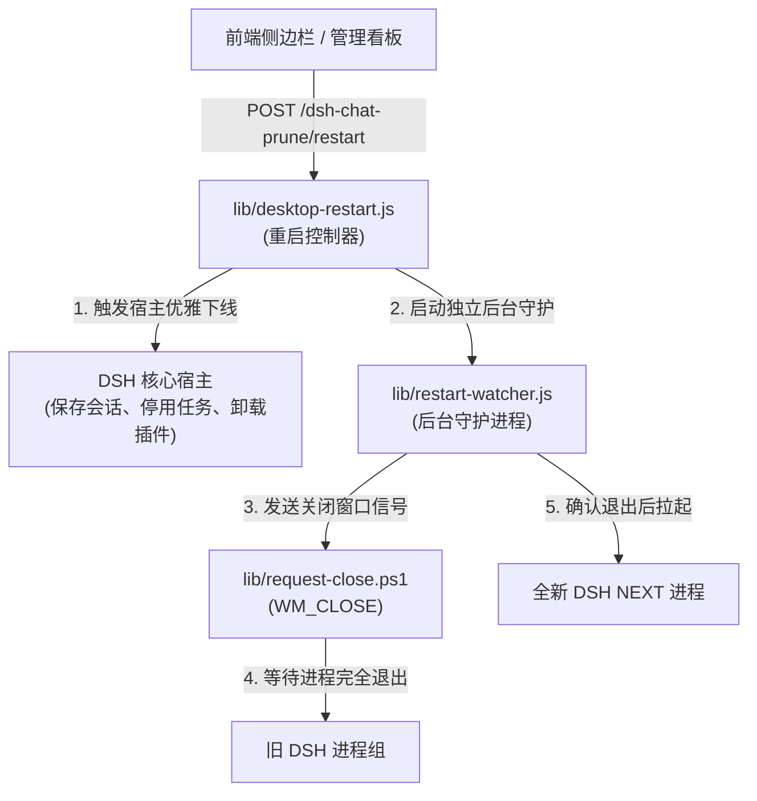

# 技术说明 (Technical Reference)

普通使用与操作指引请先阅读 [使用指南](./user-guide.md)。  
本文深入说明 DSH Chat Prune 的底层架构、宿主交互契约、物理删除安全性边界、HTTP 接口规范、存储压缩格式以及桌面端平滑重启机制。

---

## 目录
- [1. 物理删除流程与安全边界](#1-物理删除流程与安全边界)
- [2. 备份与灾难恢复机制](#2-备份与灾难恢复机制)
- [3. 内部 HTTP RPC 接口](#3-内部-http-rpc-接口)
- [4. 压缩存储与迁移格式规范](#4-压缩存储与迁移格式规范)
- [5. 桌面端平滑重启架构](#5-桌面端平滑重启架构)
- [6. 核心模块与职责分工](#6-核心模块与职责分工)
- [7. 主题变量适配规范](#7-主题变量适配规范)

---

## 1. 物理删除流程与安全边界

为确保绝对不损坏用户数据、不产生脏读或悬挂索引，删除流程设计为严格串行的 7 步守卫：

1. **路径合法性校验**：  
   校验对话 ID 格式，定位实际会话物理路径，并通过 `realpath` 验证该目录严格位于宿主当前 DSH 数据根目录内部，拒绝符号链接或目录联接越界。
2. **活动生命周期检测与优雅释放**：  
   坚决拒绝正在生成中、执行工具调用或存在外部未完结任务的会话；对已跟踪且处于 `idle` 空闲态的 Agent，调用底层 `AgentHandle.dispose()` 完成空闲等待、scope 清理、writer 关闭及注册表摘除。
3. **获取宿主排它写锁 (Write Ownership)**：  
   在线时调用宿主 `sessionPersistence.open(id, 'write')` 取得写入所有权并保持至清理完毕；若宿主因内部被其他模块占用而无法完整释放，坚决拒绝删除。
4. **全量备份优先保护**：  
   若开启备份（单条指定或全局开启），先完整克隆会话物理目录至安全区并生成 `restore.json`；若备份出现任何异常，立即阻断并退出整个流程。
5. **物理目录与缓存移除**：  
   先解构并安全物理删除会话目录，随后彻底清除对应投影缓存目录（`storages/session_projcache/sessions/<id>.json`）及其备份。
6. **宿主索引原子更新**：  
   通过公开的 `workspaceRegistry` API 移除工作区内绑定 ID，同步清理置顶与归档索引。**严禁**在外层直接强行改写在线宿主的 `workspace.json` 文件。
7. **客户端两阶段刷新**：  
   调用宿主公开的 `sessions.refresh()` 刷新底层正式会话名单，随后向前端推送变更并重绘插件列表。

> [!CAUTION]
> **跨平台安全策略**  
> 在线物理删除依赖 Windows 提供的强制独占文件句柄保护。在 POSIX 系统（macOS/Linux）下，目录移除可能导致锁文件脱离，因此在线物理删除在非 Windows 环境下明确返回 `501 Not Implemented`，保障数据绝对安全。

---

## 2. 备份与灾难恢复机制

### 备份目录结构
备份数据存放于对应数据根目录的 `deleted-sessions/` 之中。目录名包含毫秒级时间戳与随机唯一摘要，杜绝并发覆盖：

```text
<DSH 数据根目录>/
  deleted-sessions/
    20261106-034500-a1b2c3/
      restore.json           # 索引恢复指引与元数据
      session-8a2cf300-.../  # 完整的物理目录，包含所有原始事件与嵌套附件
        session.v4.jsonl.zstd
        attachments/
```

### 灾难恢复操作准则
1. **停止宿主**：正常退出 DSH NEXT，建议提前另存一份当前的 `storages/workspace.json`。
2. **查阅恢复清单**：打开备份目录下的 `restore.json`，核验会话 ID 及其对应的原始路径 `originalPath` 与所属工作区。
3. **回拷目录**：将备份会话目录复制回 `originalPath`。若原路径已存在同名残留，先另行备份再覆盖。
4. **恢复索引**：在 `storages/workspace.json` 中找到对应的工作区条目，将该会话 ID 重新加入其 `sessionIds` 列表中；如此前处于置顶或归档态，按需在对应数组补充。
5. **拉起 DSH**：启动 DSH NEXT，历史对话与附件即刻完整可见。

---

## 3. 内部 HTTP RPC 接口

路由基于宿主自带的 WebServer 认证体系进行转发，仅响应同源或携带安全认证的本地请求。

| 方法 | 路径 | 用途与入参规范 |
|---|---|---|
| `GET` | `/dsh-chat-prune/ping` | 获取插件版本号、当前数据根目录及运行时检测能力 |
| `GET` | `/dsh-chat-prune/sessions` | 获取全景会话看板数据、运行状态保护标志及 `missing` 标记 |
| `POST` | `/dsh-chat-prune/sources` | `{ "name": "...", "home": "绝对路径", "endpoint": "本机地址(可选)" }`，添加或更新数据源 |
| `DELETE` | `/dsh-chat-prune/sources` | `{ "sourceId": "..." }`，仅移除数据源挂载，绝不删除其底下的数据 |
| `POST` | `/dsh-chat-prune/sessions/action` | `{ "sessionId": "...", "action": "archive\|unarchive\|pin\|unpin\|compress\|decompress" }` |
| `POST` | `/dsh-chat-prune/compression` | `{ "afterDays": 30 }`，配置并保存当前数据源的自动压缩天数（0 为关闭） |
| `POST` | `/dsh-chat-prune/compression/run` | 立即触发一轮自动压缩巡检，返回成功、跳过数及明细 |
| `POST` | `/dsh-chat-prune/conversations/export`| `{ "sessionIds": [...], "sourceId": "local" }`，返回 base64 编码的 `.dsh-chat.gz` |
| `POST` | `/dsh-chat-prune/conversations/import`| 原始 gzip 请求体，导入并重建会话及附件，返回已导入 ID 列表 |
| `GET` | `/dsh-chat-prune/restart` | 查询当前宿主是否支持平滑重启及当前正在运行的会话数量 |
| `POST` | `/dsh-chat-prune/restart` | 启动平滑重启流程（先优雅停机、存盘，再唤醒独立守护进程重启） |
| `DELETE`| `/dsh-chat-prune/sessions` | JSON 请求体 `{ "sessionId": "..." }` 执行单条或批量删除 |
| `DELETE`| `/dsh-chat-prune/sessions/<id>` | 路径传参删除指定对话 |
| `GET` | `/dsh-chat-prune/client.js` | 输出内联构建完成的纯自执行客户端脚本 |
| `POST` | `/dsh-chat-prune/diag` | 本地有限体积的客户端异常诊断日志回传 |

### 响应状态码规范
- `200 OK`：请求成功执行。
- `400 Bad Request`：参数缺失、JSON 解构失败或路径越界。
- `409 Conflict`：目标会话正处于活动状态、被其他句柄独占占用，或发生文件名/ID 冲突。
- `413 Payload Too Large`：迁移导入包或数据超出安全边界（上限 64 MiB）。
- `501 Not Implemented`：操作系统不支持在线安全独占删除（非 Windows 环境）。
- `503 Service Unavailable`：宿主底层持久化服务暂不可用。
- `500 Internal Server Error`：底层文件读写或索引写入异常（若发生部分成功，响应体将明确返回 `partial: true`、已删集合及备份路径）。

---

## 4. 压缩存储与迁移格式规范

### 压缩存储结构
压缩后的会话目录仅包含紧凑结构：
- `.dsh-conversation.gz`：包含历史事件流、完整附件的 gzip 二进制包（内附文件相对路径与 SHA-256 校验哈希）。
- `.dsh-conversation.json`：存放标题、更新时间戳、原始体积及 catalog 映射的元数据快照。

### 按需无感解压机制
持久化适配层包装了宿主 `sessionPersistence`：
- 在调用 `open(id, 'read' | 'write')` 之前，插件侦测目标是否处于压缩态；
- 若处于压缩态，立即将其原子化释放解压至原目录，并在毫秒级内交还原始 reader/writer；
- 界面与原生侧边栏完全透明无感知，无需手动解压即可直接点开历史对话继续聊。

### 导出迁移包规范
导出文件采用通用 `.dsh-chat.gz` 格式：
- `format` 标识为 `"dsh-chat-prune"`，版本协议 `"version": 1`。
- 每条记录包含完整的事件历史、多模态附件内容（base64 编码）、文件相对路径与时间戳。
- 导入流程具备防覆盖阻断机制：遇到任何已存在 ID（含大小写不敏感碰撞），在解压前整体拦截，杜绝污染现有工作区。

---

## 5. 桌面端平滑重启架构

由于 Electron 架构与 DSH 0.2.x 内部并未给插件预留 `app.relaunch()` 的公开通道，插件通过三个紧密协作的模块实现了安全平滑重启：



1. **`lib/desktop-restart.js`**：
   - 侦测当前是否运行在可重启的 Windows 桌面版环境中；
   - 检查是否有活动任务正在生成，若有则向用户发出醒目确认警示；
   - 调用宿主 `ctx.dispose()`，确保已打开的会话写入器完成 flush 并关闭，任务优雅停止。
2. **`lib/restart-watcher.js`**：
   - 作为一个完全脱离 Node 主事件循环的后台独立子进程启动；
   - 周期性监听目标 PID 的存活状态；
   - 在旧进程安全释放并完全退出后，调用原执行文件路径及命令行参数唤醒新客户端。
3. **`lib/request-close.ps1`**：
   - 采用标准 Win32 消息循环向 Electron 窗口投递注销级关闭消息，避免暴力杀死进程造成磁盘文件截断。

---

## 6. 核心模块与职责分工

```text
├── client-core.js            # 客户端通用确认弹窗、单条悬浮逻辑与状态总线
├── client-manager.js         # 现代化看板主界面、分页筛选、规则计算与批量控制台
├── client-slot.js            # 原生插槽模块，向 DSH 侧边栏和底部动作栏注入操作入口
├── client.js                 # 由 scripts/build-client.mjs 内联打包生成的运行期无外部依赖脚本
├── lib/
│   ├── index.js              # 插件主入口：路由挂载、宿主上下文服务接入与全局生命周期编排
│   ├── pruning-policy.js     # 纯逻辑保留规则计算器（纯函数，前后端同构复用）
│   ├── agent-lifecycle.js    # AgentHandle 生命周期劫持与空闲释放安全代理
│   ├── session-sources.js    # 多数据目录原子持久化配置、本机校验与跨来源请求代理
│   ├── conversation-package.js # 导入导出 gzip 包解析、校验哈希与反序列化守卫
│   ├── conversation-storage.js # 目录物理压缩、快照生成与按需毫秒级解压
│   ├── conversation-maintenance.js # 持久化层无感拦截、自动定时压缩调度
│   ├── desktop-restart.js    # 桌面平滑重启协调器
│   ├── restart-watcher.js    # 后台重启监听守护进程
│   └── request-close.ps1     # 优雅关闭窗口 PowerShell 脚本
```

---

## 7. 主题变量适配规范

插件设计遵循 **“完全融入宿主视觉”** 的原则，所有弹窗与组件均直接订阅 DSH 官方 CSS 变量：

- **背景与表面层**：`--dsw-alias-bg-layer-2`（主窗口面板）、`--dsw-alias-bg-layer-1`（输入框与次级卡片）
- **文字与标签**：`--dsw-alias-label-primary`（主标题与正文）、`--dsw-alias-label-secondary`（次要说明）
- **边框与阴影**：`--dsw-alias-border-l3`、`--dsw-elevation-prominent`
- **交互与危险状态**：`--dsw-alias-state-error-primary`（删除/危险操作）、`--dsw-alias-interactive-bg-hover`
- **无障碍高对比度**：严格遵循 WCAG 2.1 AA 级对比度要求（浅色与深色主题下对比度均稳定高于 4.5:1）。
