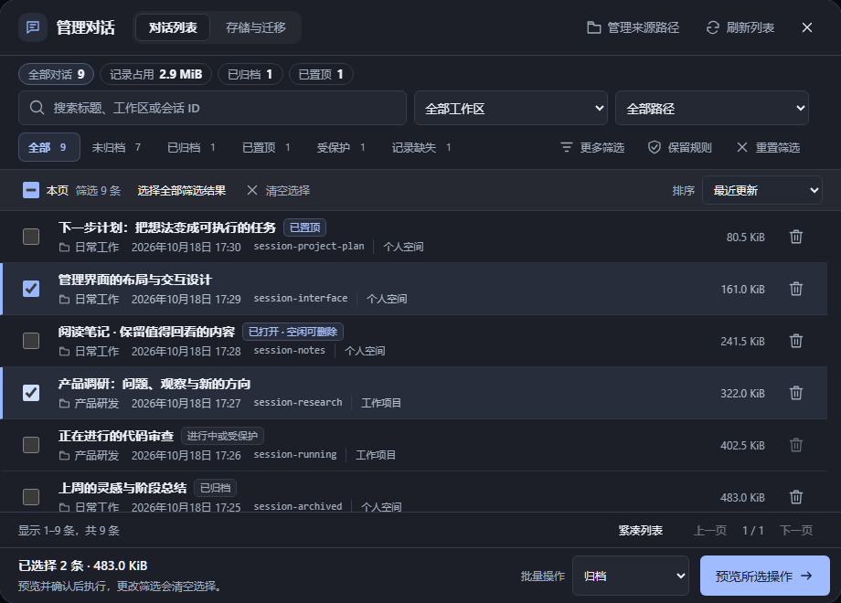
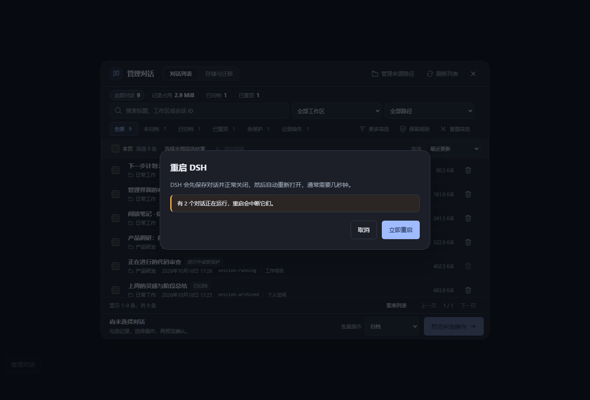
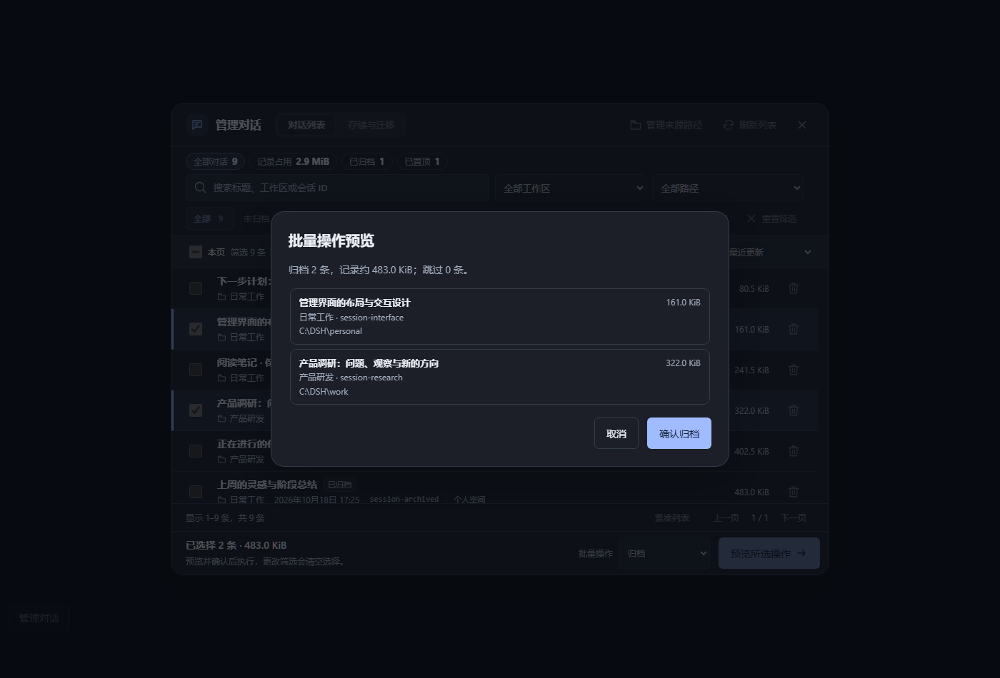
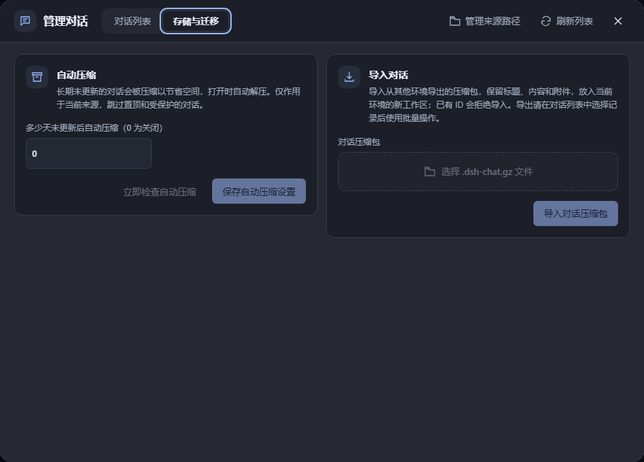
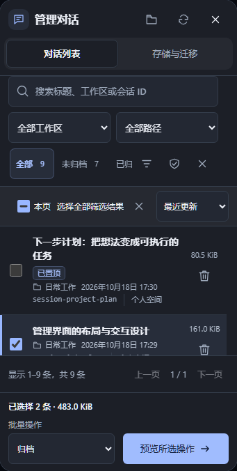

# 使用指南 (User Guide)

欢迎阅读 **DSH Chat Prune** 详细使用指南。基础安装与快速命令请参考[项目首页](../README.md)。  
本文深入介绍会话管理看板、桌面端平滑重启、多来源数据目录挂载、保留修剪规则、存储压缩与跨机迁移等核心功能的具体操作细节与常见问题解决方案。

---

## 📑 目录
- [1. 管理对话主界面](#1-管理对话主界面)
  - [桌面端平滑重启 (Desktop Restart)](#桌面端平滑重启-desktop-restart)
  - [多维检索与快捷筛选](#多维检索与快捷筛选)
- [2. 批量操作与二次核对](#2-批量操作与二次核对)
- [3. 智能保留规则与自动修剪](#3-智能保留规则与自动修剪)
- [4. 存储压缩与跨机迁移](#4-存储压缩与跨机迁移)
  - [手动压缩与按需解压](#手动压缩与按需解压)
  - [自动定时压缩配置](#自动定时压缩配置)
  - [导出迁移包与新环境导入](#导出迁移包与新环境导入)
- [5. 多来源数据路径聚合](#5-多来源数据路径聚合)
- [6. 全局备份与灾难恢复](#6-全局备份与灾难恢复)
- [7. 常见问题排查 (FAQ)](#7-常见问题排查-faq)

---

## 1. 管理对话主界面

展开 DSH NEXT 侧边栏，点击底部的 **“管理对话”** 按钮即可打开看板主界面。

<p align="center">
  
</p>

### 界面核心信息
看板中每条记录均提供透明详实的元数据：
- **标题**：解析会话日志的首条对话总结；若未命名或格式不兼容则回退展示会话 ID。
- **工作区与来源**：标明属于哪一个项目空间（如“日常工作”、“产品研发”）及对应的数据目录。
- **占用体积**：包含会话内所有非临时数据与附件的物理磁盘大小。
- **更新时间**：精确提取目录内最新修改时间。
- **保护标识**：包括“已置顶”、“已归档”、“运行中（禁止删除）”、“已打开 · 空闲可删除”以及“记录缺失”等。

---

### 桌面端平滑重启 (Desktop Restart)

在 Windows 桌面版的“管理对话”看板右上角（以及展开态侧边栏底部），插件提供了专门的 **“重启 DSH”** 快捷按钮。

<p align="center">
  
</p>

> [!NOTE]
> **为什么需要专属平滑重启？**  
> DSH 0.2.x 官方未向插件层暴露原生退出/重启的 RPC 接口。传统强制结束进程容易导致未刷盘的对话数据丢失。为此，本插件实现了一套可靠的**两阶段停机重启协议**：
> 1. **宿主内优雅下线**：插件后端主动通知 DSH 执行内部正常关闭流程——刷盘保存会话写入、安全终止后台任务、卸载插件实例。
> 2. **独立守护进程关窗**：由后台独立的轻量进程向 DSH 窗口发送安全关闭通知（WM_CLOSE）；若窗口 10 秒内未完全退出才结束进程残留。此时后端已完成存盘，历史对话完好无损。
> 3. **拉起新进程**：旧进程完全退出后，立即重新拉起相同的 DSH NEXT 客户端。
>
> 完整执行日志保存在 `%TEMP%\dsh-chat-prune-restart.log`，方便随时排查。

---

### 多维检索与快捷筛选

- **实时搜索**：支持按对话标题、工作区名称、工作区路径或会话完整 ID 模糊匹配。
- **全局快捷标签**：搜索框下方提供一键过滤按钮：
  - `全部`：查看当前来源下的所有对话。
  - `未归档` / `已归档`：按归档状态过滤。
  - `已置顶`：仅展示置顶收藏的重点会话。
  - `受保护`：快速排查正在运行中或持有外部句柄的保护记录。
  - `记录缺失`：排查索引中存在但物理文件已丢失的残留垃圾。
- **排序与展示**：支持按更新时间（最近 / 最早）、磁盘占用（最大）及标题排序；桌面端支持一键切换“紧凑列表”提升信息密度。

---

## 2. 批量操作与二次核对

针对多条记录的集中维护，插件严格贯彻 **“先预览、后核对、逐条发”** 原则。

<p align="center">
  
</p>

### 操作步骤
1. **跨页多选**：勾选记录左侧复选框。表头支持快速“选择本页”或“选择全部筛选结果”（支持跨分页连续全选）。
2. **选择动作**：从底部操作条中选择目标指令：
   - **归档记录 / 取消归档**：将不常用的历史移入归档区（归档自动移除置顶，不删除物理文件）。
   - **置顶记录 / 取消置顶**：快速标记常用会话。
   - **压缩记录 / 解压记录**：一键对历史对话执行流式压缩，释放磁盘空间。
   - **导出压缩包**：将选中会话打包为 `.dsh-chat.gz` 迁移文件。
   - **删除记录**：物理移除选中的会话目录。
3. **预览核对**：点击 **“预览所选操作”**，唤起只读模态窗口。系统将展示受影响的完整目标清单、体积汇总以及被自动跳过的保护项。
4. **受控执行**：确认无误后点击执行。系统按队列串行发送请求并实时反馈进度；若中途想要停止，可点击 **“停止后续任务”**（等待当前已发出的请求完成后停止后续队列）。

---

## 3. 智能保留规则与自动修剪

当历史对话数量达到成百上千条时，逐条挑选费时费力。通过“保留规则”可以实现智能化自动标记。

### 规则设定逻辑
在管理窗口点击工具栏中的 **“保留规则”**：
- **每个工作区保留最近条数（N）**：例如设置为 `10`，系统将以每个工作区为独立单元，按更新时间排序，前 10 条最新对话自动列为绝对安全项。
- **只修剪早于多少天的记录（Days）**：例如设置为 `30`，仅在超过 30 天未更新的旧记录中寻找候选。

### 安全保护边界
智能规则计算时会自动执行以下安全过滤：
- 置顶的对话永远不纳入候选。
- 正在运行或不可释放的对话永远不纳入候选。
- 文件缺失或更新时间未知的对话不自动纳入候选。
- 未连接本机宿主的只读来源不自动选中。

点击 **“生成修剪候选”** 后，系统自动完成勾选。修改规则数值时已生成的勾选项会自动清空，防止误执行失效规则。

---

## 4. 存储压缩与跨机迁移

DSH NEXT 的持久化日志中往往包含大量长上下文与图片/文件附件，投影缓存（projection cache）也会随时间膨胀。

<p align="center">
  
</p>

### 手动压缩与按需解压
- **无损压缩**：在列表勾选对话后点击“压缩记录”。插件将剥离可随时重建的投影缓存，并将事件流转为紧凑包。
- **无缝浏览与按需解压**：压缩后的对话在 DSH 原生侧边栏依然完整可见。当你在原生列表中点击该对话时，插件底层会自动拦截并在毫秒内将其无感解压还原；你也可以在管理窗口随时批量“解压记录”。
- **安全检查**：运行中会话或无法安全获得写入排它锁的会话会被自动拒绝压缩。

### 自动定时压缩配置
1. 在管理窗口顶部切换到 **“存储与迁移”** 分区。
2. 输入 **“多少天未更新后自动压缩”**（例如 `30`，填 `0` 表示关闭自动压缩）。
3. 点击“保存自动压缩设置”。设置将持久化至 `storages/dsh-chat-prune-compression.json`。
4. 宿主服务在后台运行期间每分钟自动轮询一次；新解压查看的对话会自动更新访问标记，防止刚打开的记录被再次自动压缩。

### 导出迁移包与新环境导入
1. **批量导出**：在“对话列表”中勾选同一数据来源的一条或多条会话，批量操作选择“导出压缩包”，系统将下载一个标准的 `.dsh-chat.gz` 文件。已压缩的会话可直接导出，无需预先解压。
2. **新环境导入**：
   - 在新设备安装 DSH NEXT 并安装本插件。
   - 打开管理窗口的“存储与迁移”选项卡。
   - 点击“选择文件”选中 `.dsh-chat.gz`，点击 **“导入对话压缩包”**。
   - 插件将自动校验完整性并写入新环境的“导入的对话”工作区中，完整恢复历史对话内容、附件与置顶/归档状态。
3. **容量与格式限制**：
   - 单包最大支持 1000 条对话、20,000 个文件，压缩包体积上限 64 MiB（解压上限 256 MiB）。
   - 为防止意外覆盖，遇到与现有 ID 冲突（含大小写冲突）时会整体拒绝导入。

---

## 5. 多来源数据路径聚合

如果你在本地维护了多个 DSH 配置文件（例如开发与日常使用不同 profile）、或者有挂载在外部硬盘的历史存档，可通过多来源进行统一管理。

### 添加来源
1. 打开管理窗口，切换到 **“管理来源路径”**。
2. 填写自定义名称和 **DSH 数据根目录的绝对路径**（该目录下需包含 `sessions/` 文件夹）。
3. 若需要对该来源执行在线删除/归档，需填写该来源对应 Web 宿主的本地服务地址（如 `http://127.0.0.1:端口/?token=...`）。未提供连接地址的目录将以**只读模式**接入，支持搜索与体积浏览，禁止写入修改。
4. 点击“保存路径”。配置将原子写入 `storages/dsh-chat-prune-sources.json`。

---

## 6. 全局备份与灾难恢复

**删除操作不可逆，开启备份让数据更安心。**

### 备份存储结构
备份文件保存在所属数据目录的 `deleted-sessions/<时间戳>/` 下，目录结构如下：
```text
<DSH 数据目录>/
  deleted-sessions/
    20261106-034500-a1b2c3/
      restore.json           # 索引恢复指引与会话元数据
      session-xxxx-xxxx/     # 完整的会话物理目录（包含所有历史与附件）
        session.v4.jsonl.zstd
        attachments/
```

### 全局强制备份开启方式
单条删除默认关闭备份，批量删除默认开启备份。如果希望永久强制开启所有删除操作的备份，可以修改配置文件：
1. 退出 DSH NEXT。
2. 找到插件配置文件：
   ```text
   <DSH 数据目录>/profiles/<profile>/node_modules/dsh-chat-prune/cordis.patch.yml
   ```
3. 将其中的 `backup: false` 改为 `backup: true`，保存并重启 DSH 即可。

### 灾难手动恢复流程
1. 退出 DSH NEXT。
2. 打开对应的 `restore.json`，核对 `originalPath` 与会话 ID。
3. 将备份目录复制回原工作区路径。
4. 根据 `restore.json` 中的说明，将该会话 ID 重新添加回 `storages/workspace.json` 中对应工作区的 `sessionIds` 数组中。
5. 重新打开 DSH NEXT，对话即刻复原。

---

## 7. 常见问题排查 (FAQ)

### Q: 为什么界面提示“进行中或受保护”，无法删除？
**A:** DSH Chat Prune 会主动检测会话写入排它锁与活动 Agent。如果会话正在进行对话生成、执行外部工具调用，或者宿主未释放底层写句柄，删除会被强行阻止以防损坏数据。可尝试切换到其他对话后稍等片刻，或使用“重启 DSH”释放残留句柄。

### Q: 在侧边栏找不到垃圾桶图标或“管理对话”入口？
**A:** 
1. 展开左侧工作区折叠面板，鼠标悬停在单条会话行上即可看到垃圾桶图标。
2. 若完全看不到，请确认插件是否已正确安装并在当前使用的 Profile 中启用。可尝试完整退出 DSH NEXT 后重新启动。

### Q: 移动端或窄屏环境下的表现如何？
**A:** 插件针对小屏幕和响应式布局进行了专门优化：

<p align="center">
  
</p>

在窄屏下，工具栏自适应为紧凑图标，状态栏支持横向顺滑滑动，核心的“全选”与“批量操作”按钮始终保持固定在视口底部易于点击。

### Q: 键盘快捷操作有哪些？
- `/`：在列表任意位置按斜杠键，焦点立即返回顶部搜索框并选中文本。
- `Esc`：在批量预览模态框中按 Esc 可安全取消并返回主窗口；在批量任务执行中按 Esc 可请求在当前项完成后优雅停止。
- `Tab` / 方向键：支持全键盘访问各选项卡、单选框与操作项。
